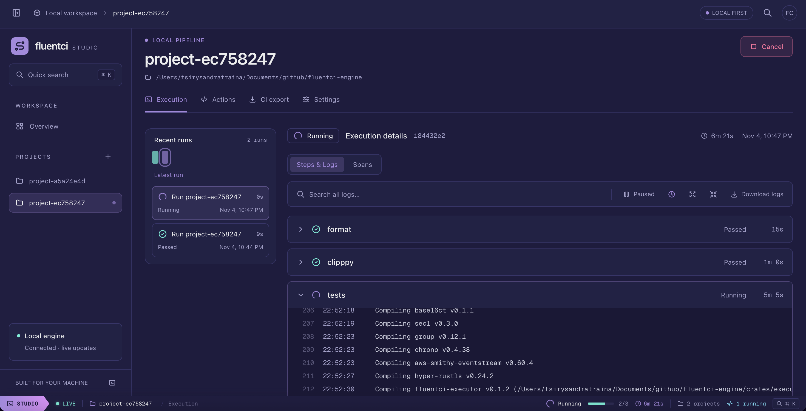

# FluentCI

[](https://github.com/fluentci-io/fluentci/actions/workflows/ci.yml)
[](https://github.com/fluentci-io/fluentci/actions/workflows/release.yml)
[](https://discord.gg/V4U6dPskKc)

FluentCI is a programmable CI/CD tool for building, testing, and deploying your
code locally or on a runner. The Rust CLI combines the
[FluentCI Engine](https://github.com/fluentci-io/fluentci-engine) and
[FluentCI Studio](https://github.com/fluentci-io/fluentci-studio) in one executable.

Run WebAssembly plugins on the host, compose pipelines in TOML, or manage projects
through Studio. The CLI uses Clap and Tokio, serves its GraphQL API and web UI
through Axum, and persists application data in SQLite through SQLx.

## Contents

- [Features](#features)
- [Build and install](#build-and-install)
- [Quick start](#quick-start)
- [Pipeline configuration](#pipeline-configuration)
- [WebAssembly plugins](#webassembly-plugins)
- [Studio and GraphQL](#studio-and-graphql)
- [Projects and CI exports](#projects-and-ci-exports)
- [Commands](#commands)
- [Database and settings](#database-and-settings)
- [Caching](#caching)
- [Tracing and logging](#tracing-and-logging)
- [Development](#development)
- [Contributing](#contributing)

## Features

- **One executable:** the CLI embeds Studio assets and links the Wasm engine;
  no separate Studio or engine binary is downloaded.
- **Host execution:** Wasm plugins run on the host with environment providers
  including Nix, Pkgx, Devbox, Flox, Devenv, Hermit, EnvHub, Pixi, and Mise.
- **Reusable pipelines:** search the FluentCI Registry, run published plugins,
  and initialize projects from templates.
- **Pipeline composer:** define named steps, environment variables, and working
  directories in TOML, or edit project actions in Studio.
- **Persistent execution history:** store projects, actions, runs, jobs, logs,
  and settings in SQLite, with transactional writes and schema migrations.
- **Live feedback:** stream execution events over WebSockets, inspect job logs,
  and cancel active runs from Studio.
- **CI exports:** generate GitHub Actions, GitLab CI, Azure Pipelines, CircleCI,
  and AWS CodeBuild manifests from saved project actions.
- **Engine integrations:** use the engine's secret providers, local and remote
  caches, services, and OpenTelemetry tracing from plugins.
- **Existing pipelines:** continue to execute TypeScript/Dagger pipelines with
  their Deno and Dagger runtimes.

## Build and install

Build this Rust port from a checkout with Rust **1.96 or newer** and Bun installed:

```sh
cd webui
bun install --frozen-lockfile --ignore-scripts
bun run build:web
cd ..
cargo build --release --locked
```

Build Studio before compiling Rust: its generated assets are embedded in the
executable. Bun and Node are build dependencies, and are not needed to serve the
compiled Studio UI.

Run the binary directly:

```sh
./target/release/fluentci --help
./target/release/fluentci studio
```

Or install it into a directory on your `PATH`:

```sh
mkdir -p "$HOME/.local/bin"
install -m 755 target/release/fluentci "$HOME/.local/bin/fluentci"
```

Published archives are listed on the
[releases page](https://github.com/fluentci-io/fluentci/releases). Older releases
contain the previous CLI; build this branch to use the unified Rust executable.
The release workflow builds Linux and macOS archives for x86_64 and ARM64.

### Runtime tools

| Workflow | Additional tools |
| --- | --- |
| Studio, GraphQL, project management | None |
| Shell steps | Bash and the tools invoked by the step |
| Published Wasm plugins | Tools required by the plugin or its environment provider |
| Building local Rust plugins | Cargo, Rustup, and the `wasm32-unknown-unknown` target |
| TypeScript/Dagger pipelines and REPL | Deno and Dagger; Docker when required by the pipeline |
| Terminal documentation | Glow |
| Service controls | Overmind and its Unix sockets |

Plugins and requested toolchains may be downloaded during execution. Hosted
registry and runner commands require network access.

## Quick start

Initialize and run a pipeline in your project directory:

```sh
fluentci init
fluentci ls
fluentci run
```

The generated `.fluentci/fluentci.toml` contains a `hello` step. Run a named step
or choose a different working directory:

```sh
fluentci run . hello
fluentci run --work-dir ./my-project .
```

Search for a reusable pipeline and run a Wasm plugin:

```sh
fluentci search rust
fluentci run --wasm rust test
```

Start Studio:

```sh
fluentci studio
```

## Pipeline configuration

FluentCI reads `.fluentci/fluentci.toml`, falling back to `fluentci.toml` in the
project root. Commands can be a string or an array executed in order:

```toml
[package]
name = "my-pipeline"
version = "0.1.0"

[[steps]]
name = "check"
command = ["cargo fmt --all --check", "cargo clippy -- -D warnings"]

[[steps]]
name = "test"
command = "cargo test"
env = ["CI=true", "RUST_BACKTRACE=1"]

[[steps]]
name = "frontend"
command = "fluentci run --wasm bun run test"
working_directory = "webui"
```

Shell steps run through Bash. A single `fluentci run` command is represented as a
plugin action. `.fluentci/.env` supplies environment variables to child processes;
step variables take precedence. Use `fluentci env` to display that file's values.

See [fixtures](./fixtures) for configuration examples across languages and
frameworks.

## WebAssembly plugins

The linked engine uses Extism to execute WebAssembly plugins. Write plugins in
Rust or use one of the engine's
[guest SDKs](https://github.com/fluentci-io/fluentci-engine/tree/main/sdk).

### Rust plugin example

Generate a minimal plugin:

```sh
fluentci init hello-plugin --wasm
```

This creates a Rust library in `.fluentci` with an Extism export:

```rust
use extism_pdk::*;

#[plugin_fn]
pub fn hello() -> FnResult<String> {
    Ok("Hello from FluentCI".into())
}
```

Run its `hello` export:

```sh
fluentci run --wasm . hello
```

The CLI installs the Wasm target, builds the local plugin, and invokes the linked
engine through a worker mode in the same executable. This isolates engine
working-directory and environment changes from concurrent API requests.

You can also run an already compiled module:

```sh
fluentci run --wasm ./target/wasm32-unknown-unknown/release/hello_plugin.wasm hello
```

Use `--standalone` with `init --wasm` to generate a reusable plugin in the current
directory. Publishing requires a FluentCI access token:

```sh
fluentci login
fluentci publish --wasm
```

### Environment providers and built-in functions

The engine's Rust PDK exposes `dag()` for environment setup, commands, pipelines,
files, directories, Git repositories, HTTP resources, and services. For example:

```rust
use extism_pdk::*;
use fluentci_pdk::dag;
use fluentci_types::nix::NixArgs;

#[plugin_fn]
pub fn exec(command: String) -> FnResult<String> {
    let stdout = dag()
        .nix(NixArgs { impure: true })?
        .with_exec(command.split_whitespace().collect())?
        .stdout()?;
    Ok(stdout)
}
```

This example additionally uses the `fluentci-pdk` and `fluentci-types` crates. See
the [engine's plugin guide](https://github.com/fluentci-io/fluentci-engine#-plugins)
for available plugins and provider examples. Engine-specific commands such as
`fluentci-engine execute` are not exposed as top-level commands by this CLI.

## Studio and GraphQL

Studio serves the web UI, GraphQL API, and live events on one loopback address:

```sh
fluentci studio --port 6076
```

- Studio: <http://localhost:6076>
- GraphQL and GraphiQL: <http://localhost:6076/graphql>
- WebSocket events: `ws://localhost:6076/ws`

Local Studio does not require a hosted account. Set `FLUENTCI_NO_OPEN=1` to prevent
the CLI from opening a browser automatically. To run only the API:

```sh
fluentci server --port 6076
```

Studio registers the current directory as a project. Saved project actions and
execution history are shared with CLI commands through the same SQLite database.

## Projects and CI exports

```sh
fluentci project create
fluentci project list
fluentci project show <name>
```

To associate a newly created project with the current directory and run its
configured actions:

```sh
FLUENTCI_PROJECT_ID=<name> fluentci run .
```

Export saved project actions as YAML:

```sh
fluentci project export <name> --github
fluentci project export <name> --gitlab
fluentci project export <name> --azure
fluentci project export <name> --circleci
fluentci project export <name> --aws
```

Exports are written to standard output. Redirect the output to the appropriate CI
configuration file. GitHub Actions is the default provider when no flag is given.

## Commands

Run `fluentci --help` or `fluentci <command> --help` for arguments and options.

| Commands | Purpose |
| --- | --- |
| `run`, or no subcommand | Execute local or published pipelines |
| `init`, `search` | Create pipelines and find reusable packages |
| `ls` / `list`, `docs` / `man` | List pipeline jobs and read documentation |
| `studio`, `server` | Start the embedded UI or local GraphQL API |
| `project create`, `list`, `show`, `export` | Manage saved projects and export CI manifests |
| `login`, `whoami`, `publish` | Authenticate and publish packages |
| `agent`, `agent list` | Connect a hosted runner agent or list agents |
| `repl` | Start a Deno/Dagger REPL |
| `up`, `down`, `ps`, `status`, `start`, `restart`, `stop`, `echo` | Control services and stream their logs |
| `env`, `doctor`, `upgrade`, `community` | Inspect configuration, diagnose tools, update, and find support |

For hosted execution, set `FLUENTCI_PROJECT_ID` and authenticate with `fluentci
login` or `FLUENTCI_ACCESS_TOKEN`, then use `fluentci run --remote-exec`. Service
controls discover `.fluentci/*/Procfile` and use the associated Overmind sockets.

## Database and settings

The default application database is `~/.fluentci/fluentci.db`. Override it with a
global option or environment variable:

```sh
fluentci --database ./fluentci.db studio
FLUENTCI_DATABASE=./fluentci.db fluentci project list
```

SQLx applies embedded migrations when opening the database. SQLite stores projects,
ordered actions, runs, jobs, logs, access tokens, agent identity, and update-check
settings. WAL mode and a busy timeout support concurrent CLI and Studio access;
foreign keys cascade dependent records when a project is deleted.

Existing Deno KV data is not automatically migrated. A legacy access-token file is
imported on first authenticated use. The engine's build caches and execution
journals retain their own file formats; they are separate from the application
database. See [migration details](./docs/rust-port.md#persistence).

## Caching

The embedded engine supports local and remote caches. Configure remote storage
with the same variables used by FluentCI Engine:

| Variable | Purpose |
| --- | --- |
| `FLUENTCI_CACHE_GCS_BUCKET` | Google Cloud Storage bucket |
| `FLUENTCI_CACHE_S3_ENDPOINT` | S3-compatible endpoint, including R2 |
| `FLUENTCI_CACHE_S3_BUCKET` | S3-compatible bucket |
| `FLUENTCI_CACHE_CDN_ENDPOINT` | Optional CDN endpoint for downloading cached data |

GCS uses `GOOGLE_APPLICATION_CREDENTIALS`. S3-compatible storage uses
`AWS_ACCESS_KEY_ID` and `AWS_SECRET_ACCESS_KEY`.

## Tracing and logging

The engine supports OpenTelemetry tracing through `OTEL_EXPORTER_OTLP_ENDPOINT`
or `OTEL_EXPORTER_ZIPKIN_ENDPOINT`. It also supports a Jaeger agent through
`OTEL_EXPORTER_JAEGER_AGENT_HOST` and Baselime logging through `BASELIME_API_KEY`.
Set `RUST_LOG` to configure the CLI's diagnostic logging.

## Development

Build the UI before running Rust checks:

```sh
cd webui
bun install --frozen-lockfile --ignore-scripts
bun run build:web
bunx tsc --noEmit
cd ..
cargo fmt --all --check
cargo clippy --all-targets --locked -- -D warnings
cargo test --locked
```

For frontend development, start `cargo run -- server` and then run `bun run dev`
inside `webui`. Vite proxies `/graphql` and `/ws` to the local API on port 6076.
`nix develop` provides a development shell with Rust, Bun, and build tools.

See [Rust development notes](./docs/rust-port.md) for architecture and runtime
requirements, and the [engine](./engine/UPSTREAM.md) and
[Studio](./webui/UPSTREAM.md) source notes for the imported revisions.

## Contributing

Questions, suggestions, and bug reports are welcome through
[GitHub issues](https://github.com/fluentci-io/fluentci/issues/new) and
[Discord](https://discord.gg/V4U6dPskKc). Use the development instructions above to
build and validate changes to the unified Rust CLI.

FluentCI is licensed under the [Mozilla Public License 2.0](./LICENSE). Imported
engine and Studio sources retain their license notices.
