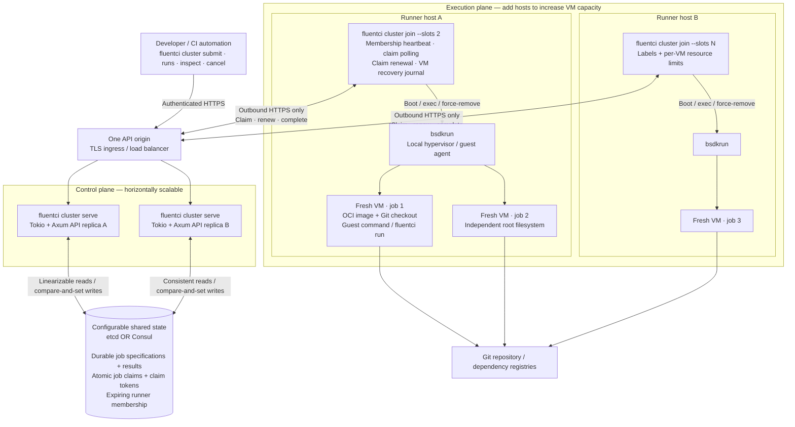

# Horizontally scalable FluentCI VM runners

The same `fluentci` binary supplies the API, runner, and developer commands.
Runner hosts pull jobs from one logical API entry point. Each job boots a fresh
Linux VM with bsdkrun; job code never executes directly on the runner host.

`fluentci cluster join` is runner registration, analogous to adding a GitLab or
GitHub runner. It registers a long-lived host, not an individual job VM. The
registered host advertises labels and parallelism, polls for work, creates a new
VM for every job, and remains available for subsequent jobs. `fluentci cluster
runners` lists the registered hosts.



## Job lifecycle

```mermaid
sequenceDiagram
    participant D as Developer
    participant API as Any Axum API replica
    participant S as etcd / Consul
    participant R as fluentci cluster join
    participant B as bsdkrun
    participant VM as Fresh Linux VM

    R->>B: Probe VM capability; recover journaled orphan VMs
    R->>API: Register runner ID, labels, slots, resource limits
    API->>S: Store membership with 30-second expiry
    D->>API: Submit UUID + image + repo/ref + argv + resources
    API->>S: Compare-and-set create durable queued job
    API-->>D: Run ID (same UUID makes submission retries idempotent)
    R->>API: Poll for compatible job when a local slot is free
    API->>S: Compare-and-set queued → running(owner, claim token, expiry)
    S-->>API: Exactly one claimant wins this job
    API-->>R: Claimed job + unique claim token
    R->>R: Persist VM cleanup journal
    R->>B: Boot named, fresh VM with requested image / CPU / memory
    B->>VM: Start isolated guest
    R->>B: Probe guest-agent readiness using true
    R->>B: Execute fixed checkout wrapper + positional guest argv
    B->>VM: Clone HTTPS Git repository; checkout ref; execute command
    loop Every 10 seconds while executing
        R->>API: Renew runner membership and job claim
        API->>S: Refresh membership; compare-and-set matching job claim
    end
    VM-->>B: Exit status + stdout / stderr
    B-->>R: Bounded execution output
    R->>B: Force-remove this job's VM
    R->>R: Remove cleanup journal after verified removal
    R->>API: Publish result using owner + claim token
    API->>S: Compare-and-set running → succeeded / failed
    D->>API: Inspect run
    API->>S: Read durable status + result
    API-->>D: Status, exit code, bounded logs, or execution error
```

## State transitions and failure boundaries

```mermaid
stateDiagram-v2
    [*] --> Queued: Idempotent submission UUID
    Queued --> Running: Atomic claim by compatible runner
    Queued --> Cancelled: Developer cancels
    Running --> Succeeded: VM removed; current claimant publishes success
    Running --> Failed: VM removed; current claimant publishes failure
    Running --> Cancelled: Developer cancels; renewal fails; runner removes VM
    Running --> Lost: Claim expires / runner disappears
    Succeeded --> [*]
    Failed --> [*]
    Cancelled --> [*]
    Lost --> [*]
```



- API replicas are stateless. They share the cluster name, secret, backend, and
  durable queue. No elected API leader or separate FluentCI server/client binary
  is needed. etcd/Consul itself remains an external state dependency.
- The API generates and displays a random 256-bit bearer token when no token is
  configured. Set `FLUENTCI_CLUSTER_TOKEN` to use the same token across restarts
  and replicas; runners and developer commands use that environment variable
  to authenticate. Authentication is required on every API route.
- Runner hosts need outbound access to the API, OCI registry, and Git sources.
  They do not expose an inbound machine API or require state-backend credentials.
- A FluentCI node can join at any time with
  `fluentci cluster join --api <cluster-origin>`. Registration immediately adds its labels and capacity to
  discovery; its next poll can claim compatible queued work. Existing nodes,
  API replicas, and running jobs do not need a restart or a fixed node inventory.
- The runner bounds local concurrency with `--slots`; matching considers labels,
  available host CPU count, and the configured maximum memory per VM. Operators
  must size slots and resources to fit the host; this is not host provisioning
  or automatic infrastructure scaling.
- Job claims use backend compare-and-set operations. Only the current,
  unexpired owner/claim token may renew or complete a running job. An expired
  claim is reported as `lost`, never automatically requeued: arbitrary CI work
  can have side effects that cannot be safely repeated.
- Membership and claims expire after 30 seconds without renewal. API clocks must
  be synchronized. Backend unavailability prevents new admission/claims;
  failed claim renewal makes a live runner tear down its VM.
- Cancellation is cooperative through claim renewal, normally within 10 seconds
  plus request/cleanup time. A partitioned or crashed host cannot be remotely
  fenced by a database token; a stranded guest may run until the host recovers.
  Lost jobs require operator review before explicit resubmission.
- VM cleanup precedes result publication. Cleanup failures retain the local
  journal and stop new work on that runner. Restarting with the same work
  directory removes journaled VMs before joining again. VM/image downloads
  remain bsdkrun-managed; no persistent root volume is shared between jobs.
- The initial executor supports Linux OCI VMs. Images must supply `sh`, `git`,
  and the requested tools. To execute a FluentCI pipeline, include the Linux
  `fluentci` binary in the image and submit `fluentci run` as the guest command.
- Run status and bounded final logs are shared. Artifact storage, live log
  streaming, private Git credential injection, queue retention/indexing,
  autoscaling infrastructure, and BSD guest adapters are separate extensions.

See [cluster commands and configuration](cluster.md) for usage.
